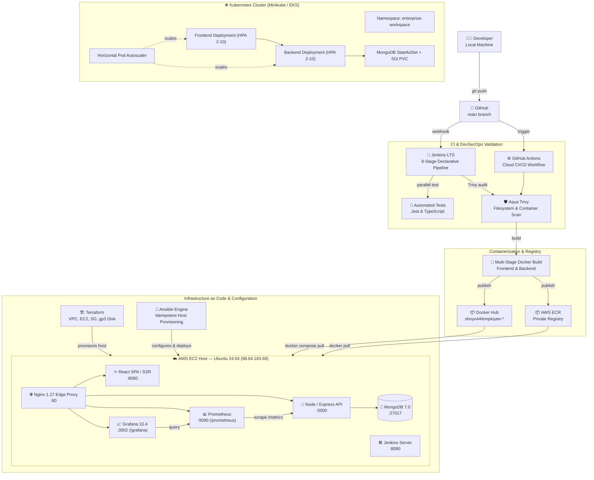

# 🏗️ Enterprise DevOps Architecture

This document provides a comprehensive blueprint of the end-to-end continuous integration, continuous delivery, infrastructure provisioning, and observability architecture for the **Enterprise AI Workspace (Employee Management Platform)**.

---

## 🌐 End-to-End Pipeline & Deployment Flow

---

## 🔒 Security & Traffic Boundaries

1. **Edge Proxy Boundary**:
   - Only ports `80` (HTTP), `22` (SSH), `3002` (Grafana), `8080` (Jenkins), and `9090` (Prometheus) are reachable externally.
   - Internal microservices (`mongo:27017` and `backend:5000`) communicate exclusively over the private Docker bridge network (`enterprise_net`).
2. **Shift-Left DevSecOps**:
   - Vulnerability scanning is enforced automatically during code check-in and before image promotion.
3. **Resilience & Swap Hardening**:
   - The Linux kernel is tuned with a 2 GB persistent swapfile and `vm.swappiness=10` to guarantee memory stability during high-throughput loads on AWS Free Tier instances.

