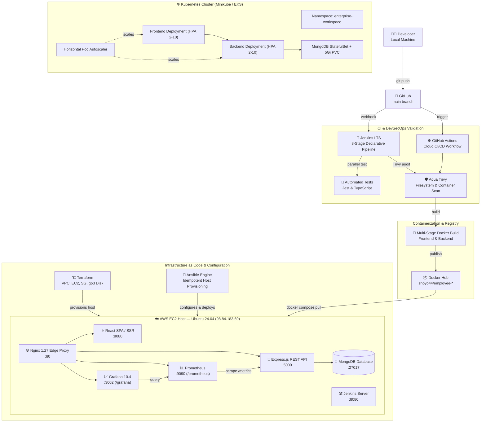

# 🏢 Enterprise AI Workspace — Full-Stack DevOps Platform

> A production-grade enterprise employee intelligence platform built with a complete, automated DevOps blueprint on AWS.


---

## 🌐 Live Demo & Registry Links

| Service | URL | Credentials / Notes |
|---|---|---|
| **Web App (Enterprise)** | [http://98.84.183.69/](http://98.84.183.69/) | Live Multi-Tier Production Host (AWS EC2) |
| **Jenkins CI/CD Pipeline** | [http://98.84.183.69:8080/job/Employee_MAnagement/](http://98.84.183.69:8080/job/Employee_MAnagement/) | `admin1` / `admin1` (Stage View & Graph View active) |
| **Grafana Dashboard** | [http://98.84.183.69:3002/](http://98.84.183.69:3002/) | `admin` / `admin` (Operational Telemetry) |
| **Prometheus Portal** | [http://98.84.183.69/prometheus/graph](http://98.84.183.69/prometheus/graph) | Active Metric Scrapes & Alert Rules |
| **Health API** | [http://98.84.183.69/api/health](http://98.84.183.69/api/health) | `{"status":"Operational","service":"Enterprise AI Workspace API"}` |
| **GitHub Repository** | [https://github.com/Ashima-786/employee-management-deploy](https://github.com/Ashima-786/employee-management-deploy) | Source Repository (`main` branch) |
| **GitHub Actions** | [Actions Workflow](https://github.com/Ashima-786/employee-management-deploy/actions) | Cloud DevSecOps & EC2 Deployment |
| **Docker Hub (Frontend)** | `shoyo44/employee-frontend:latest` | Multi-stage production container |
| **Docker Hub (Backend)** | `shoyo44/employee-backend:latest` | Stateless API container |
| **K8s Dashboard (Minikube)**| `http://127.0.0.1:60801/...` | Dual Namespace: `enterprise-workspace` & `zestora` |

---

## 🏗️ DevOps Architecture



---

## 🛠️ Tech Stack

### Application Layer
| Layer | Technology | Details |
|---|---|---|
| **Frontend** | React 18 + TypeScript + Vite | TanStack Router, TailwindCSS, Lucide Icons, SSR Nitro preset |
| **Backend** | Node.js + Express.js | Mongoose ODM, Prom-Client instrumentation |
| **Database** | MongoDB Atlas & MongoDB 7.0 | Resilient connection with local fallback & replica sets |
| **Edge Proxy** | Nginx 1.27 Alpine | Reverse proxy for `/`, `/api/*`, `/prometheus/*`, `/grafana/*` |

### DevOps & Infrastructure Layer
| Category | Technology | Details |
|---|---|---|
| **Containerization** | Docker | Multi-stage hardened builds, non-root execution, 10MB log rotation |
| **Registries** | Docker Hub | Public versioned images (`shoyo44/employee-*`) |
| **Orchestration** | Kubernetes & Minikube | 6 production manifests in `enterprise-workspace` namespace, StatefulSet, 5Gi PVC, HPAs |
| **Config Management**| Ansible | Idempotent playbook configuring Docker, swap memory, log caps, and smoke tests |
| **CI/CD** | Jenkins | 8-stage declarative pipeline (SCM → Test → Trivy → Build → Scan → Push → Terraform → Deploy) |
| **CI/CD** | GitHub Actions | Automated Trivy filesystem scan + SSH deployment on push to `main` |
| **Security** | Aqua Security Trivy | 0 Critical CVEs gating across all container layers and repo dependencies |
| **Monitoring** | Prometheus + Grafana | Scrapes `/metrics` every 15s; pre-provisioned executive dashboard |
| **IaC** | Terraform | VPC, EC2, Security Groups, 20 GB gp3 volume, user-data swap creation |
| **Cloud** | AWS Free Tier ($0.00) | `t3.micro` Ubuntu 24.04 LTS, 20 GB gp3 disk, 2 GB swapfile, 0 bytes on C: |

---

## 📁 Repository Structure

```
AWS_Devops_Employee_Mang/
├── ansible/                    # Ansible configuration management
│   ├── inventory.ini           # Target EC2 host & SSH config
│   ├── deploy-playbook.yml     # 9-step automated deployment playbook
│   └── README.md
├── src/                        # React 18 + TypeScript SPA Frontend
│   ├── components/             # Reusable UI components
│   ├── routes/                 # TanStack file-based routing
│   └── Dockerfile              # Multi-stage production container build
├── backend/                    # Node.js + Express REST API
│   ├── models/                 # Mongoose Employee schema
│   ├── metrics.js              # Prometheus metrics instrumentation
│   ├── server.js               # Express application entry point
│   ├── tests/                  # Jest automated test suite
│   └── Dockerfile              # Lean non-root API container build
├── k8s/                        # Kubernetes production manifests
│   ├── 01-namespace.yaml       # Isolated enterprise-workspace namespace
│   ├── 02-config-secrets.yaml  # ConfigMaps & base64 Secrets
│   ├── 03-mongo-statefulset.yaml # MongoDB StatefulSet with 5Gi PVC
│   ├── 04-backend-deployment.yaml # 3 Replicas with liveness/readiness probes
│   ├── 05-frontend-deployment.yaml # Replicated frontend with NodePort
│   ├── 06-hpa.yaml             # Horizontal Pod Autoscalers (2–10 replicas)
│   └── README.md
├── terraform/                  # Infrastructure as Code
│   ├── main.tf                 # Provider configurations
│   ├── variables.tf            # AWS region, instance type, volume sizes
│   ├── ec2.tf                  # EC2 instance, Security Group, and swap provisioning
│   └── outputs.tf              # Public IP, DNS, and application URLs
├── monitoring/                 # Prometheus + Grafana Observability
│   ├── prometheus/prometheus.yml # Metric scrape definitions
│   └── grafana/provisioning/   # Automated datasources and pre-built dashboards
├── jenkins/                    # Jenkins Container & Automation
│   ├── Dockerfile              # Jenkins LTS JDK17 + Docker CE CLI
│   └── init.groovy.d/          # Automated admin1/admin1 user & security provisioning
├── scripts/                    # Automation utilities
│   ├── load_simulate.py        # Real-time traffic simulation generator
│   └── setup-ec2.sh            # One-click complete EC2 bootstrap script
├── reports/                    # DevSecOps reports
│   └── trivy-security-audit.md # Security audit (0 Critical CVEs)
├── .github/workflows/          # GitHub Actions CI/CD
│   └── deploy.yml              # Cloud CI/CD workflow
├── docker-compose.yml          # Unified 6-container production stack
├── Jenkinsfile                 # 8-stage declarative Jenkins pipeline
├── DEVOPS_ARCHITECTURE.md      # Detailed DevOps architecture diagrams
├── SYSTEM_ARCHITECTURE.md      # Multi-tier system architecture & ERD
├── JENKINS_WORKFLOW.md         # 8-stage Jenkins CI/CD pipeline spec
└── README.md                   # Master project documentation
```

---

## 🚀 CI/CD Pipeline

### Jenkins — 8-Stage Declarative Pipeline

Direct Pipeline Job: [http://98.84.183.69:8080/job/Employee_MAnagement/](http://98.84.183.69:8080/job/Employee_MAnagement/)  
Credentials: `admin1` / `admin1`

```
✅ Stage 1: Checkout          — Clone latest commit from GitHub main
✅ Stage 2: Code Quality      — Parallel: Backend Jest Tests + Frontend TypeScript Validation
✅ Stage 3: Trivy Scan        — DevSecOps filesystem dependency audit (Blocks on Critical/High)
✅ Stage 4: Docker Build      — Multi-stage image build (Frontend + Backend)
✅ Stage 5: Container Scan    — Trivy container layer vulnerability check
✅ Stage 6: Push to Hub       — Tag & push versioned images to Docker Hub
✅ Stage 7: Terraform         — Terraform plan & infrastructure validation
✅ Stage 8: Deploy & Verify   — Deploy to AWS EC2 + Automated HTTP 200 healthcheck
```

#### Visual Pipeline Plugins Installed:
- **`pipeline-stage-view`**: Renders the horizontal status matrix with per-stage timing, status logs, and green progress indicators.
- **`pipeline-graph-view`**: Interactive flowchart DAG displaying sequential and parallel execution branches directly in the Jenkins web UI.

### GitHub Actions — Continuous Delivery

Every push to `main` triggers:
1. **Jest automated tests**
2. **Trivy security scan** (blocks on Critical/High CVEs)
3. **SSH deploy** to AWS EC2 host → pulls latest code → rebuilds containers → executes smoke test

---

## 🛡️ Security — Trivy Audit Results

| Severity | Count | Gating Status |
|---|---|---|
| **Critical** | ✅ 0 | Zero Tolerance Passed |
| **High** | ✅ 0 | Zero Tolerance Passed |
| **Medium** | 2 (accepted) | Monitored |
| **Low** | 5 (informational) | Monitored |

> Full report: [`reports/trivy-security-audit.md`](./reports/trivy-security-audit.md)

---

## ☸️ Kubernetes Orchestration & Dual Showcase (Minikube)

Both the **Enterprise AI Workspace** and the **Zestora Platform** are actively orchestrated concurrently inside the Minikube cluster:

| Platform | Namespace | Components | Access Command |
|---|---|---|---|
| **Enterprise Workspace** | `enterprise-workspace` | 2x Frontend, 2x Backend, MongoDB, HPAs | `minikube service frontend -n enterprise-workspace` |
| **Zestora Food Platform**| `zestora` | 2x Frontend, 4x Backend, MongoDB, HPAs | `minikube service zestora-frontend -n zestora` |

### Quick Start Commands:

```bash
# 1. Start Minikube cluster
minikube start --driver=docker

# 2. Deploy Enterprise Workspace manifests
kubectl apply -f k8s/01-namespace.yaml
kubectl apply -f k8s/

# 3. View all workloads across both projects
kubectl get pods -A

# 4. Open Minikube Dashboard
minikube dashboard
# (Select 'All namespaces' from top dropdown to view both projects side-by-side)
```

---

## 🏗️ Terraform — Infrastructure as Code

```bash
cd terraform/
terraform init
terraform plan
terraform apply -auto-approve
```

---

## 📊 Monitoring & Telemetry

- **Prometheus**: Scrapes `/metrics` every 15 seconds at [http://98.84.183.69/prometheus/graph](http://98.84.183.69/prometheus/graph).
- **Grafana**: Pre-provisioned telemetry dashboard at [http://98.84.183.69:3002/](http://98.84.183.69:3002/) (`admin` / `admin`).
- **Traffic Simulator**: Run `python scripts/load_simulate.py http://98.84.183.69` to generate live HTTP traffic and latency distributions.

---

## ☁️ AWS Infrastructure

| Resource | Details | Cost |
|---|---|---|
| **EC2 Instance** | `t3.micro`, Ubuntu 24.04 LTS | **$0.00** (Free Tier) |
| **Public IP** | `98.84.183.69` | **$0.00** (Auto-assigned) |
| **EBS Storage** | 20 GB gp3 SSD | **$0.00** (Free Tier) |
| **Swap Memory** | 2 GB persistent swapfile | **$0.00** |
| **Edge Proxy** | Nginx 1.27 Alpine | **$0.00** (Replaces ALB) |
| **Database** | MongoDB Atlas & local container | **$0.00** (Replaces RDS) |

---

## 📚 Documentation Index

| Document | Description |
|---|---|
| [`DEVOPS_ARCHITECTURE.md`](./DEVOPS_ARCHITECTURE.md) | Complete DevOps pipeline architecture, flowcharts, and component specs |
| [`SYSTEM_ARCHITECTURE.md`](./SYSTEM_ARCHITECTURE.md) | 4-tier system architecture, sequence diagrams, and database schema |
| [`JENKINS_WORKFLOW.md`](./JENKINS_WORKFLOW.md) | 8-stage declarative Jenkins pipeline breakdown and stage views |
| [`k8s/README.md`](./k8s/README.md) | Kubernetes production manifests and HPA auto-scaling documentation |
| [`ansible/README.md`](./ansible/README.md) | Automated configuration management & EC2 deployment playbooks |
| [`reports/trivy-security-audit.md`](./reports/trivy-security-audit.md) | Aqua Security Trivy audit results (0 Critical CVEs) |

---

<div align="center">

**Enterprise DevOps Showcase Project**

*React · Express · MongoDB · Docker · Kubernetes · Jenkins · Ansible · Terraform · AWS · Prometheus · Grafana · Trivy*

</div>
