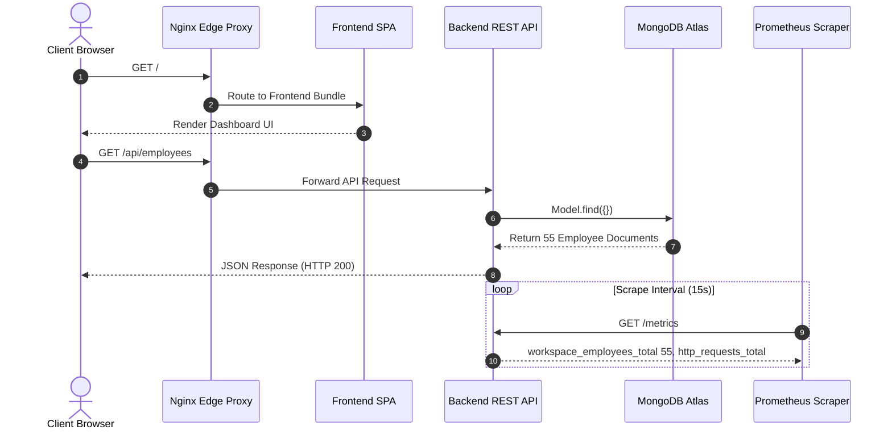

# 🏛️ System Architecture Specification

The **Enterprise AI Workspace** delivers proactive work intelligence, employee performance telemetry, and cross-functional capacity metrics.

---

## 🏗️ 4-Tier Application Architecture

```mermaid
graph TD
    User["👨‍💼 End User Browser"] -->|HTTPS / HTTP :80| Proxy["🛡️ Nginx 1.27 Edge Proxy"]

    subgraph "Tier 1: Presentation Tier"
        Proxy -->|/ (Root Navigation)| Frontend["⚛️ React 18 + TanStack Router SPA\nTailwind CSS, Lucide Icons"]
    end

    subgraph "Tier 2: Application Tier"
        Proxy -->|/api/*| Backend["🚀 Express.js Stateless REST API\nMongoose ODM, Prom-Client Telemetry"]
    end

    subgraph "Tier 3: Persistence Tier"
        Backend -->|Mongoose Connection| Mongo[("🍃 MongoDB Database\nCollection: employees")]
    end

    subgraph "Tier 4: Observability Tier"
        Proxy -->|/prometheus/*| Prom["📊 Prometheus Scraper :9090"]
        Proxy -->|/grafana/*| Graf["📈 Grafana Visual Dashboards :3002"]
        Prom -->|GET /metrics| Backend
        Graf -->|PromQL Queries| Prom
    end
```

---

## 📊 Database Schema (MongoDB `employees`)

```typescript
interface IEmployee {
  _id: ObjectId;
  id: string;                    // Unique slug / ID (e.g., 'alex_morgan_102')
  name: string;                  // Full employee name
  role: string;                  // Position / Title (e.g., 'DevOps Engineer')
  team: string;                  // Organization division (e.g., 'Cloud Infrastructure')
  initials: string;              // UI avatar initials (e.g., 'AM')
  color: string;                 // Avatar styling accent (e.g., 'blue', 'violet')
  activeTasks: number;           // Current sprint tasks in progress
  priorityTasks: number;         // Critical / Blocker tasks assigned
  commitments: number;           // Deliverable commitments for milestone
  meetings: number;              // Scheduled meetings count
  workload: "Balanced" | "Elevated" | "High"; // Calculated risk indicator
}
```

---

## 🔄 Core User & Telemetry Sequences


